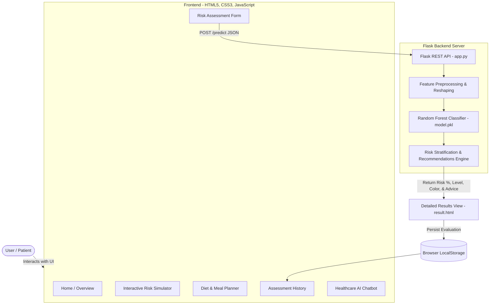

# 🩺 AI-Based Diabetes Prediction & Healthcare Assistant System

[](https://www.python.org/)
[](https://flask.palletsprojects.com/)
[](https://scikit-learn.org/)
[](https://developer.mozilla.org/)
[](LICENSE)

An intelligent, full-stack healthcare web application designed to assess, predict, and monitor the risk of diabetes using Machine Learning. The application evaluates key patient physiological indicators, classifies diabetes risk into actionable severity tiers, and delivers comprehensive personalized recommendations, diet planning, real-time risk simulation, and an integrated AI health assistant.

---

## 📑 Table of Contents

- [Key Features](#-key-features)
- [System Architecture](#-system-architecture)
- [Project Directory Structure](#-project-directory-structure)
- [Machine Learning Model](#-machine-learning-model)
  - [Input Clinical Parameters](#input-clinical-parameters)
  - [Risk Stratification Levels](#risk-stratification-levels)
- [Tech Stack](#-tech-stack)
- [Installation & Quickstart](#-installation--quickstart)
  - [Prerequisites](#prerequisites)
  - [1. Clone / Navigate to Project](#1-clone--navigate-to-project)
  - [2. Set Up a Virtual Environment](#2-set-up-a-virtual-environment)
  - [3. Install Required Dependencies](#3-install-required-dependencies)
  - [4. (Optional) Re-train the ML Model](#4-optional-re-train-the-ml-model)
  - [5. Run the Application](#5-run-the-application)
- [API Reference](#-api-reference)
- [Application Pages](#-application-pages)
- [Medical Disclaimer](#-medical-disclaimer)

---

## ✨ Key Features

- **🔬 High-Accuracy Predictive Analytics**: Powered by a trained **Random Forest Classifier** that evaluates multiple clinical and lifestyle markers to compute an exact risk probability.
- **⚡ Real-Time Health Risk Simulator (`analytics.html`)**: Interactive sliders allowing users to dynamically simulate how adjusting glucose, BMI, blood pressure, and age impacts their risk scores in real-time.
- **🥗 Diabetic Meal & Lifestyle Planner (`diet.html`)**: Tailored meal guidance catering to diverse objectives (Blood Sugar Control, Prevention, Weight Management, High Protein), alongside a Glycemic Index reference chart and daily hydration tracker.
- **📊 Comprehensive Diagnostic Result Report (`result.html`)**: Animated radial score meters, risk classification badges, physiological factor breakdowns, and printable medical summaries.
- **📁 Local Assessment History (`history.html`)**: Tracks and stores past patient evaluations locally with search filtering, status-based badges, and record management.
- **🤖 Built-in Healthcare AI Chatbot (`chatbot.js`)**: Interactive assistant widget providing instant answers to diabetes-related questions, diet inquiries, symptoms, and lifestyle tips with session history support.
- **🌓 Dark & Light Mode Support (`theme.js`)**: Clean, responsive, accessible interface with instant theme switching.

---

## 🏛 System Architecture



---

## 📁 Project Directory Structure

```text
├── backend/
│   ├── app.py              # Flask server and REST API endpoints
│   ├── model.pkl           # Serialized pre-trained Random Forest model
│   └── train_model.py      # ML model training, evaluation, and serialization script
├── dataset/
│   └── diabetes.csv        # Medical dataset containing diabetes clinical records
├── frontend/
│   ├── about.html          # Educational information, symptoms, and tech stack details
│   ├── analytics.html      # Interactive risk simulator with real-time sliders
│   ├── chatbot.css         # Styling for the floating AI assistant widget
│   ├── chatbot.html        # AI assistant layout reference
│   ├── chatbot.js          # Healthcare chatbot logic, knowledge base, and session history
│   ├── diet.html           # Goal-based meal planning, glycemic index & water tracker
│   ├── history.html        # Patient assessment history log
│   ├── history.js          # History data rendering, filtering, and deletion
│   ├── index.html          # Main landing page
│   ├── predict.html        # Patient input diagnostic form
│   ├── result.html         # Diagnostic report and visualization page
│   ├── result.js           # Animated risk meter and dynamic report generator
│   ├── script.js           # Form validation and API communication
│   ├── style.css           # Global stylesheet with light and dark mode variables
│   └── theme.js            # Theme toggle handler (Dark / Light mode)
└── README.md               # Project documentation
```

---

## 🧠 Machine Learning Model

The core predictive engine uses a **Random Forest Classifier** configured with 300 estimators and stratified train-test splitting to ensure balanced class distributions during training.

### Input Clinical Parameters

| Parameter | Type | Unit / Format | Description |
| :--- | :---: | :---: | :--- |
| `Pregnancies` | Integer | Count | Number of pregnancies (0 for males/nullipara) |
| `Glucose` | Float | mg/dL | Fasting plasma glucose concentration |
| `BloodPressure`| Float | mmHg | Diastolic blood pressure |
| `BMI` | Float | $\text{kg/m}^2$ | Body Mass Index (weight in kg / height in $\text{m}^2$) |
| `Age` | Integer | Years | Age of the individual |
| `FamilyHistory`| Binary | 0 or 1 | Immediate family history of diabetes (0 = No, 1 = Yes) |
| `HeartDisease` | Binary | 0 or 1 | Pre-existing cardiovascular disease history (0 = No, 1 = Yes) |
| `Smoking` | Binary | 0 or 1 | History of tobacco consumption (0 = No, 1 = Yes) |

### Risk Stratification Levels

| Risk Score (%) | Classification | Indicator Color | Recommended Action |
| :---: | :---: | :---: | :--- |
| **0% – 30%** | **Low Risk** | 🟢 `#2ecc71` | Maintain balanced diet, regular exercise, hydration, and periodic checkups. |
| **31% – 60%** | **Moderate Risk** | 🟡 `#f39c12` | Reduce refined sugar, manage weight, exercise 30+ mins daily, and monitor glucose. |
| **61% – 100%** | **High Risk** | 🔴 `#e74c3c` | Consult a medical doctor immediately for clinical diagnosis and lab testing. |

---

## 🛠 Tech Stack

- **Machine Learning & Data Processing**: Python, [scikit-learn](https://scikit-learn.org/), [pandas](https://pandas.pydata.org/), [numpy](https://numpy.org/), [joblib](https://joblib.readthedocs.io/)
- **Backend Web Server**: [Flask](https://flask.palletsprojects.com/), [Flask-CORS](https://flask-cors.readthedocs.io/)
- **Frontend Architecture**: HTML5, CSS3, JavaScript (Vanilla ES6+)
- **Icons & Styling**: [FontAwesome 6.5](https://fontawesome.com/), Custom responsive CSS design system

---

## 🚀 Installation & Quickstart

### Prerequisites

Ensure you have **Python 3.8 or higher** installed on your system. Verify using:
```bash
python --version
```

### 1. Clone / Navigate to Project

```bash
cd "path/to/project changes - Copy"
```

### 2. Set Up a Virtual Environment

It is recommended to use a virtual environment to manage dependencies:

- **Windows (PowerShell / Command Prompt):**
  ```powershell
  python -m venv venv
  .\venv\Scripts\activate
  ```

- **Linux / macOS:**
  ```bash
  python3 -m venv venv
  source venv/bin/activate
  ```

### 3. Install Required Dependencies

Install dependencies using the provided `requirements.txt`:

```bash
pip install -r requirements.txt
```

Or install manually:
```bash
pip install flask flask-cors pandas scikit-learn numpy joblib
```

### 4. (Optional) Re-train the ML Model

The repository includes a ready-to-use `model.pkl`. If you wish to retrain the model on the updated dataset:

```bash
cd backend
python train_model.py
```
*This will evaluate the model, output the accuracy and classification report, and save a fresh `model.pkl`.*

### 5. Run the Application

Start the Flask server from the `backend` directory:

```bash
# Make sure you are inside the backend directory
cd backend
python app.py
```

Open your browser and navigate to:
```
http://127.0.0.1:5000
```

---

## 🔌 API Reference

### Predict Diabetes Risk

Calculates probability and classifies risk level for a submitted set of health metrics.

- **URL**: `/predict`
- **Method**: `POST`
- **Content-Type**: `application/json`

#### Request Body Example:
```json
{
  "pregnancies": 2,
  "glucose": 135,
  "bloodPressure": 80,
  "bmi": 28.4,
  "age": 35,
  "familyHistory": 1,
  "heartDisease": 0,
  "smoking": 0
}
```

#### Response Example:
```json
{
  "risk": 42.67,
  "level": "Moderate Risk",
  "color": "#f39c12",
  "recommendation": "Your diabetes risk is moderate. Reduce sugar intake, maintain a healthy weight, exercise at least 30 minutes daily and monitor your blood glucose regularly."
}
```

---

## 🖥 Application Pages

| Route | Page | Purpose |
| :--- | :--- | :--- |
| `/` | `index.html` | Landing page introducing the system, health tips, and quick actions |
| `/predict-page` | `predict.html` | Health diagnostic input form for submitting clinical indicators |
| `/result` | `result.html` | Interactive assessment results, risk gauge, and printable report |
| `/analytics` | `analytics.html` | Real-time parameter simulator and risk correlation analysis |
| `/diet` | `diet.html` | Diabetic dietary schedules, meal recommendations, and water tracker |
| `/history` | `history.html` | View, filter, and manage previous evaluation logs |
| `/about` | `about.html` | Overview of diabetes symptoms, prevention methods, and system technology |

---

## ⚕ Medical Disclaimer

> **IMPORTANT**: This application is built for **educational and risk estimation purposes only**. It does not constitute formal medical diagnosis, clinical advice, or treatment plans. Users should always consult a licensed physician or healthcare professional for clinical diabetes testing and medical evaluation.

---

## 📄 License

This project is licensed under the [MIT License](LICENSE).
